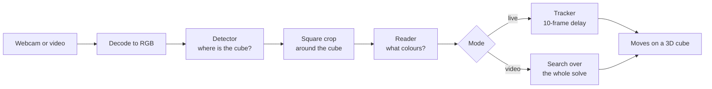

# cubevision

Rubik's Cube vision, native on the PC. cubevision finds a cube in a webcam feed or a video, reads the
colours of its stickers, and works out the moves that were made, to replay them on a 3D cube.

It runs the same algorithms as the vision part of the web app [ChronoCube](https://chronocube.vercel.app),
rewritten in Rust so that it runs faster on a PC, with the GPU you have (NVIDIA, AMD or Intel) or the
CPU alone. It is a technical showcase: clone it, build it, and see what it does and how. For everyday
use (timer, reconstructions, community), use ChronoCube.

> **Status: early.** What exists today is the first step: a prototype that proves Rust can carry the
> models, the video and the webcam. The two apps (live mode and video mode with the 3D cube) are being
> written; the [roadmap](#roadmap) says what comes in which order.
>
> **Try it on Windows in two minutes:** download `cubevision-prototype-windows-x64.zip` from the
> [latest release](https://github.com/10FX/cubevision/releases/latest), unzip it and double-click
> `test.bat`. It measures the models on your GPU (any brand) and CPU, and your webcam, and writes
> `results.txt`. Nothing to install.

## Contents

- [What it will do](#what-it-will-do)
- [How it works](#how-it-works)
- [Models](#models)
- [Measured so far](#measured-so-far)
- [Running the prototype](#running-the-prototype)
- [Repository layout](#repository-layout)
- [Roadmap](#roadmap)
- [Licence](#licence)

## What it will do

Two independent modes.

**Live: `cubevision live`.** Point the webcam at a solved cube, white on top and green in front, and
turn it. Each move is written 10 frames after you make it (a third of a second at 30 fps), once the
tracker is sure of it, and a written move never changes afterwards. A 3D cube plays the moves. Faces
are named by the colour of their centre, so you can hold and rotate the cube any way you like.

**Video: `cubevision video solve.mp4 --scramble "R U R' …"`.** Give a video of a solve and its scramble.
cubevision returns every move of the solve, played on a 3D cube that follows the cube's orientation in
the video, with a playback bar that keeps the cube, the video and the move list in step. It also gives
the rotations, wide moves and slices, the CFOP steps and their times, and the turns per second. If the
scramble was done with other colours on top and in front, say so with `--top` and `--front`. With
`--json` you get the same result without a window.

## How it works

Every frame goes through the same chain. Only what happens to the readings differs between the modes.



### 1. Find the cube

The **detector** (SSDLite320 with a MobileNetV3 backbone) sees the whole frame, shrunk into a 320×320
square with grey bars on the short side ("letterbox"). It returns one box around the whole cube and a
score; below 0.5 there is no cube.

A cube far from the camera is only a few pixels wide in that square. So when the box is smaller than a
quarter of the frame, or when nothing was found near the box followed so far, the detector looks again
at a square four times the box's size around it, and that second look gives the final box. On portrait
phone videos this second look is what finds the cube: 99 % of frames with it, about one in ten without.

### 2. Read the faces

The **reader** (MobileNetV4, 224×224) gets a square crop of the cube, 1.5 times the box's longer side,
and returns for one image:

| Output | Shape | Meaning |
|---|---|---|
| `present` | 6 | for each face, the probability that it can be read in this image |
| `stickers` | 6 × 9 × 7 | for each face and each of its 9 stickers, the probabilities of the 6 colours and of "hidden" |
| `turning` | 1 | the probability that a layer is between two positions: such an image is not used |
| `orientation` | 3 × 3 | the rotation of the whole cube in the camera's frame |

Faces are identified by the colour of their centre, which never moves under a face turn, so holding the
cube differently is not a move. The reader does not say how a face is rotated in the image (it reads it
"up to a quarter turn"); the next step sorts that out.

### 3. From readings to moves

The camera rarely sees a turn clearly (fingers, motion blur), but between two turns the cube is still
and some faces can be read. The moves are found by **search** over cube states, not by watching hands:

- **Video mode.** The scrambled state at the start is known (from the scramble), and the solved state at
  the end. One beam search goes forward from the scramble, reading after reading: every state kept may
  stay put, make one turn, or a few when the time between readings allows, and each reading scores the
  states by how well they match the colours seen. Another beam goes backward from the solved cube. The
  solve is where they meet. If they never meet (a stretch no frame saw), they are joined across the gap
  with up to eight turns, or the gap is reported.
- **Live mode.** A tracker keeps several hypotheses about the cube's state and extends each one every
  frame by staying put or by one turn (two after frames where nothing could be read). One frame cannot
  always tell two turns apart; the next ones can. After 10 frames the leading hypothesis is written, and
  the ones that contradict it are dropped.

Two details make the search robust. A face read may be completely wrong (a grid seen across a hand,
stickers swapped by blur), so every face read has a set probability of saying nothing about the cube: a
confident mistake costs no more than random colours, instead of ruling out the true state. And when the
crop did not change between two readings (nothing moved), no turn is allowed between them.

The reader sees a slice or a wide move as face turns (M looks like R L', Rw like L). In video mode the
`orientation` output puts them back: the whole cube's orientation is snapped to the 24 ways of holding
a cube, a change of hold is a rotation (x, y, z), and a rotation at the moment of a turn makes a wide
move or a slice with it (L + x = Rw).

### 4. Hardware

The models are trained once and exported to ONNX. The same file runs everywhere through
[ONNX Runtime](https://onnxruntime.ai); only the execution provider changes:

| Hardware | Windows | Linux | Tested |
|---|---|---|---|
| NVIDIA GPU | CUDA (DirectML also works) | CUDA | yes, RTX 5060 Ti |
| Intel CPU | OpenVINO or CPU | OpenVINO or CPU | yes, i5-12400F (CPU provider) |
| Intel GPU | OpenVINO | OpenVINO | not yet |
| AMD GPU | DirectML | MIGraphX | no |

GPUs run the fp16 models, the CPU the fp32 ones; it is the same network. A device you ask for by name
is the device you get: if it cannot start, the program stops with a message instead of quietly falling
back to the CPU.

## Models

| Model | Network | Input | Trained on |
|---|---|---|---|
| Detector v4 | SSDLite320, MobileNetV3 | whole frame, 320×320 | torchvision's COCO weights, then Blender renders |
| Reader v7 | MobileNetV4 conv medium | crop of the cube, 224×224 | timm's ImageNet backbone, then 646,053 Blender renders |

The renders are synthetic cubes in random states, with 3D hands, lighting and blur, drawn by Blender
over background photos from [COCO](https://cocodataset.org). No real footage of anyone is used. COCO
photos are not redistributed here; the training code (to come in `training/`) will download them for
whoever wants to retrain.

On 39 synthetic test solves, v7 reconstructs 31 exactly. ChronoCube uses a variant fine-tuned on real
footage, which is not published, so cubevision does not yet promise to reconstruct real videos reliably.

**Download:** `cubevision-models-v7.zip` in the
[releases](https://github.com/10FX/cubevision/releases) (Apache-2.0). Unzip it and name its folder in
`CUBE_MODELS`. It holds the detector and the reader in fp16 (GPU) and fp32 (CPU), and their metadata
with validation figures and SHA-256 sums. A `cubevision fetch-models` command will do this for the apps.

## Measured so far

The prototype, on an RTX 5060 Ti and an i5-12400F. Raw numbers in
[`spikes/capture-infer/results`](spikes/capture-infer/results), the full write-up (in French) in
[`FINDINGS.md`](spikes/capture-infer/FINDINGS.md).

| Measure | Result |
|---|---|
| Same outputs as Python's ONNX Runtime | CPU fp32 within 1e-4, CUDA fp16 within 1e-2 |
| Detector + reader, one frame, p95 | CUDA 13.8 ms on Windows, 15.8 ms on WSL; DirectML 12.7 ms; CPU 15.6 ms |
| Reader in batches of 8, per image | CUDA 1.1 ms, CPU 8.4 ms |
| 1080p 60 fps video, decode to reading | 120 fps (twice real time), cube found on every frame |
| Portrait 480×854 video at 30 fps | 46 fps, cube found on 99.2 % of frames |
| Webcam 1280×720 on Windows | every frame the camera sends: 15 fps here, as with ffmpeg; 30 fps still to measure in good light |

## Running the prototype

The prototype in [`spikes/capture-infer`](spikes/capture-infer) is a measuring tool: it prints JSON and
does not show moves yet. Its program is called `spike`.

On Windows, the ready-made zip of the [latest release](https://github.com/10FX/cubevision/releases/latest)
is the quickest way: `spike.exe`, ONNX Runtime 1.24.4 with DirectML (Intel, AMD and NVIDIA GPUs), the
models, and `test.bat`, which runs the commands below and writes `results.txt`. Its `README.txt` shows
how to run them by hand. The rest of this section builds from source.

### Requirements

- [rustup](https://rustup.rs). The toolchain is pinned in `rust-toolchain.toml` (Rust 1.92.0) and is
  installed on the first build.
- [uv](https://docs.astral.sh/uv/). The setup scripts use it to fetch ONNX Runtime's libraries from
  PyPI (with CUDA 13 and cuDNN for NVIDIA); you write no Python.
- [ffmpeg](https://ffmpeg.org) and ffprobe, for videos and for the tests.
- For CUDA, an NVIDIA driver recent enough for CUDA 13. On WSL2 the Windows driver is enough.
- The models (see [Models](#models)).

### Linux or WSL2

```sh
cd spikes/capture-infer
./setup-ort.sh                       # ONNX Runtime 1.31.1 into ort/, writes ort/env
. ort/env                            # tells the program where ONNX Runtime is
export CUBE_MODELS=/path/to/cubevision-models-v7
cargo build --release
```

WSL2 does not see the webcam, so the `cam` command is Windows only.

### Windows (PowerShell)

```powershell
cd spikes\capture-infer
.\setup-ort.ps1                      # ONNX Runtime 1.31.1 (CUDA) into ort\venv, 1.24.4 (DirectML) into ort\dml
. .\ort\cuda.ps1                     # or . .\ort\dml.ps1 for DirectML
$env:CUBE_MODELS = 'C:\path\to\cubevision-models-v7'
cargo build --release
```

DirectML needs its own ONNX Runtime (1.24.4, its last release): load `ort\dml.ps1` before using
`--device directml`, and `ort\cuda.ps1` for `cuda` and `cpu`.

### Commands

`--device` is `cuda`, `directml` or `cpu`. `--precision` is `fp16` or `fp32`, by default fp16 on a GPU
and fp32 on the CPU.

**Model speed** on a fixed image:

```sh
cargo run --release -- infer --device cuda --seconds 20
```

Prints the detector's and the reader's times (p50, p95), their total per frame, and the time per image
when the reader or the detector get batches of 8.

**A video read end to end**: decode, detector with its second look, crop, reader, in batches of 8.

```sh
cargo run --release -- video solve.mp4 --device cuda
```

Prints the video's codec, size and frame rate, the frames processed per second, the share of frames
where the cube was found, and the mean time per frame of each stage. Phone videos with a rotation in
their metadata are handled. Use `--ffmpeg PATH` if ffmpeg is not on your PATH (ffprobe must sit next to
it).

**The webcam** (Windows):

```powershell
cargo run --release -- cam --index 0 --width 1280 --height 720 --fps 30 --seconds 30
cargo run --release -- cam --seconds 30 --device cuda
```

The first measures the camera alone: the format it really runs, the frames delivered per second, their
share of the announced rate, and the gaps between frames. The second also reads each new frame with the
models, as the live mode will, and adds the share of frames with a cube and the reading time; hold a
cube in front of the camera for a meaningful result. No image is saved.

A webcam can deliver fewer frames than it announces: many halve their rate in dim light to expose
longer. If `delivered_share` is near 0.5, add light.

### Tests

```sh
cargo test                           # needs . ort/env, CUBE_MODELS and ffmpeg
```

- Unit tests: letterbox, crops and the second look, against values from ChronoCube's TypeScript.
- Parity: the models' outputs on a fixed input against `tests/reference.json`, written by
  `tools/make_reference.py` with ONNX Runtime in Python.
- Video: test clips are made by ffmpeg on the fly (rotation, truncated file, missing ffmpeg).

Three tests are ignored by default; run one with `cargo test -- --ignored <name>`:

- `cuda_fp16_is_close_to_python` needs CUDA.
- `cuda_refused_without_cuda` needs an ONNX Runtime without CUDA, to check the refusal.
- `a_batch_finds_what_frame_by_frame_finds` needs `CUBE_TEST_VIDEO`, a video of a cube being solved.

## Repository layout

```
docs/superpowers/specs/   the design (in French): modes, architecture, models, tests
docs/superpowers/plans/   the plan of each step
spikes/capture-infer/     the prototype: models, video and webcam from Rust, with its results
```

The apps will be a Rust workspace, one crate per job, each knowing nothing of the ones after it:

| Crate | Job |
|---|---|
| `cube-core` | cube state, notation, the 24 ways to hold a cube, CFOP steps; no dependencies |
| `cube-decode` | from readings to moves: the search, the live tracker, orientation, mirrored videos |
| `cube-infer` | ONNX models, choice of hardware, following the box, crops |
| `cube-capture` | frames from the webcam or a video file |
| `cube-view` | the 3D cube and the window |
| `cubevision` | the program and its commands |

`cube-core` and `cube-decode` need neither ONNX, nor a camera, nor a GPU, and are tested on their own
against results produced by ChronoCube's TypeScript.

## Roadmap

1. ~~Prototype: models, video and webcam from Rust, measured.~~ Done; webcam at 30 fps still to confirm.
2. `cube-core`, then `cube-decode`, checked against ChronoCube's results.
3. `cube-infer` and `cube-capture`.
4. Video mode in JSON, compared with the web app on the same synthetic videos.
5. `cube-view`: 3D cube, live mode, replay.
6. `training/` (Blender renders, training, export), `cubevision bench`, `cubevision fetch-models`, CI.
7. A larger reader for the PC, trained on renders only.

## Licence

Apache-2.0 for the code and the models. See [LICENSE](LICENSE). The Windows zip also carries ONNX
Runtime (MIT), DirectML and the Visual C++ runtime from Microsoft, under their own terms (its
`licenses` folder).
