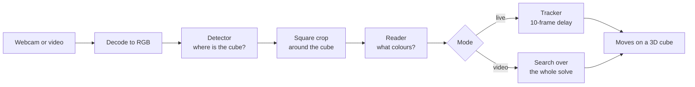

# cubevision

Rubik's Cube vision, native on the PC. cubevision finds a cube in a webcam feed or a video, reads the
colours of its stickers, and works out the moves that were made, to replay them on a 3D cube.

It runs the same algorithms as the vision part of the web app [ChronoCube](https://chronocube.vercel.app),
rewritten in Rust so that it runs faster on a PC, with the GPU you have (NVIDIA, AMD or Intel) or the
CPU alone. It is a technical showcase: clone it, build it, and see what it does and how. For everyday
use (timer, reconstructions, community), use ChronoCube.

> **Status: early, and it runs.** The two modes exist: `cubevision live` writes the moves you make in
> front of the camera on a 3D cube, and `cubevision video` finds the moves of a filmed solve and plays
> them back. Underneath, five crates rewrite ChronoCube's vision in Rust and are checked against it.
> Still to come: the video's picture and the cube's measured orientation in the replay, the training
> code, benchmarks and CI; the [roadmap](#roadmap) says what comes in which order.
>
> **Try it on Windows in two minutes:** download `cubevision-windows-x64.zip` from the
> [latest release](https://github.com/10FX/cubevision/releases/latest), unzip it and double-click
> `live.bat`. Hold a solved cube in front of the camera, white on top, green facing it, and turn it.
> Nothing to install; no image is saved.

## Contents

- [What it does](#what-it-does)
- [How it works](#how-it-works)
- [Running it](#running-it)
- [Models](#models)
- [Measured so far](#measured-so-far)
- [Running the prototype](#running-the-prototype)
- [The decoder, checked against ChronoCube](#the-decoder-checked-against-chronocube)
- [From a frame to readings](#from-a-frame-to-readings)
- [Repository layout](#repository-layout)
- [Roadmap](#roadmap)
- [Licence](#licence)

## What it does

Two independent modes.

**Live: `cubevision live`.** Point the webcam at a solved cube, white on top and green in front, and
turn it. Each move is written 10 frames after you make it (a third of a second at 30 fps), once the
tracker is sure of it, and a written move never changes afterwards. A 3D cube plays the moves. Faces
are named by the colour of their centre, so you can hold and rotate the cube any way you like.

**Video: `cubevision video solve.mp4 --scramble "R U R' …"`.** Give a video of a solve and its scramble.
cubevision returns every move of the solve, played on a 3D cube, with a playback bar that keeps the cube
and the move list in step (by move, at a quarter, half or full speed). It also gives the rotations, wide
moves and slices, the CFOP steps and their times, and the turns per second. Not there yet: the video's
picture next to the cube, and the cube following the orientation measured in the video. If the
scramble was done with other colours on top and in front, say so with `--top` and `--front`. With
`--json` you get the same result without a window.

## How it works

Every frame goes through the same chain. Only what happens to the readings differs between the modes.



### 1. Find the cube

The **detector** (SSDLite320 with a MobileNetV3 backbone) sees the whole frame, shrunk into a 320×320
square with grey bars on the short side ("letterbox"). It returns one box around the whole cube and a
score; below 0.5 there is no cube.

A cube far from the camera is only a few pixels wide in that square. So when the box is smaller than a
quarter of the frame, or when nothing was found near the box followed so far, the detector looks again
at a square four times the box's size around it, and that second look gives the final box. On portrait
phone videos this second look is what finds the cube: 99 % of frames with it, about one in ten without.

### 2. Read the faces

The **reader** (MobileNetV4, 224×224) gets a square crop of the cube, 1.5 times the box's longer side,
and returns for one image:

| Output | Shape | Meaning |
|---|---|---|
| `present` | 6 | for each face, the probability that it can be read in this image |
| `stickers` | 6 × 9 × 7 | for each face and each of its 9 stickers, the probabilities of the 6 colours and of "hidden" |
| `turning` | 1 | the probability that a layer is between two positions: such an image is not used |
| `orientation` | 3 × 3 | the rotation of the whole cube in the camera's frame |

Faces are identified by the colour of their centre, which never moves under a face turn, so holding the
cube differently is not a move. The reader does not say how a face is rotated in the image (it reads it
"up to a quarter turn"); the next step sorts that out.

### 3. From readings to moves

The camera rarely sees a turn clearly (fingers, motion blur), but between two turns the cube is still
and some faces can be read. The moves are found by **search** over cube states, not by watching hands:

- **Video mode.** The scrambled state at the start is known (from the scramble), and the solved state at
  the end. One beam search goes forward from the scramble, reading after reading: every state kept may
  stay put, make one turn, or a few when the time between readings allows, and each reading scores the
  states by how well they match the colours seen. Another beam goes backward from the solved cube. The
  solve is where they meet. If they never meet (a stretch no frame saw), they are joined across the gap
  with up to eight turns, or the gap is reported.
- **Live mode.** A tracker keeps several hypotheses about the cube's state and extends each one every
  frame by staying put or by one turn (two after frames where nothing could be read). One frame cannot
  always tell two turns apart; the next ones can. After 10 frames the leading hypothesis is written, and
  the ones that contradict it are dropped.

Two details make the search robust. A face read may be completely wrong (a grid seen across a hand,
stickers swapped by blur), so every face read has a set probability of saying nothing about the cube: a
confident mistake costs no more than random colours, instead of ruling out the true state. And when the
crop did not change between two readings (nothing moved), no turn is allowed between them.

The reader sees a slice or a wide move as face turns (M looks like R L', Rw like L). In video mode the
`orientation` output puts them back: the whole cube's orientation is snapped to the 24 ways of holding
a cube, a change of hold is a rotation (x, y, z), and a rotation at the moment of a turn makes a wide
move or a slice with it (L + x = Rw).

### 4. Hardware

The models are trained once and exported to ONNX. The same file runs everywhere through
[ONNX Runtime](https://onnxruntime.ai); only the execution provider changes:

| Hardware | Windows | Linux | Tested |
|---|---|---|---|
| NVIDIA GPU | CUDA (DirectML also works) | CUDA | yes, RTX 5060 Ti |
| Intel CPU | OpenVINO or CPU | OpenVINO or CPU | yes, i5-12400F (both) |
| Intel GPU | OpenVINO (DirectML also works) | OpenVINO | DirectML yes (Arc in a Core Ultra 5 125H); OpenVINO being measured |
| Intel NPU | OpenVINO | OpenVINO | being measured |
| AMD GPU | DirectML | MIGraphX | no |

CUDA and DirectML run the fp16 models; the CPU and OpenVINO the fp32 ones (OpenVINO computes in fp16 on a GPU or an NPU by itself). It is the same network. A device you ask for by name
is the device you get: if it cannot start, the program stops with a message instead of quietly falling
back to the CPU.

## Running it

On Windows the release's zip holds everything: `live.bat` (the models on any GPU with DirectML),
`live-openvino.bat` (an Intel GPU with OpenVINO), `live-cpu.bat`, a `README.txt`, and `test.bat`, which
tries every engine and the camera and writes what each gives, or its error, to `results.txt`
(`cubevision check --device … [--with-camera]` from the sources).

From the sources, with Rust 1.92 or later, the released models and an ONNX Runtime library
(the [prototype's requirements](#requirements) install one):

```sh
export CUBE_MODELS=<folder of cubevision-models-v7>
export ORT_DYLIB_PATH=<libonnxruntime.so or onnxruntime.dll>
cargo run --release -p cubevision -- live                      # the camera; R starts again
cargo run --release -p cubevision -- video solve.mp4 --scramble "R U R' U'"
cargo run --release -p cubevision -- video solve.mp4 --scramble "…" --json
```

`--device cpu|cuda|directml|openvino-cpu|openvino-gpu|openvino-npu` chooses where the models run; without
it the first that works is taken, and the window says which. The video mode needs ffmpeg 5.1 or later in
the PATH. Its exit code is 0 for a solve followed to a solved cube, 2 when it could not be, 1 for an error.

**Live.** The camera's picture is shown as in a mirror, with a frame around the cube: green when faces
are read, yellow when the cube is only seen. Moves seen but not settled yet are written in grey; ten
frames later they turn white and never change. If the 3D cube no longer matches yours, solve your cube
and press R. A slice is written as two face turns (M as R L'), a wide move as the opposite face's turn:
faces are named by their centre, which a slice moves. WSL has no camera: under Linux the camera path is
written but was tried on no real one.

**Video, against ChronoCube.** The four synthetic solves of the decoder's fixtures, read by the same
models (`cargo test -p cubevision --test site -- --include-ignored`, on an i5-12400F and an RTX 5060 Ti):

| Video | Read as the site reads (processor, frame by frame) | In batches on CUDA |
|---|---|---|
| synth-23-000 | 358 of 391 frames with the site's faces; solved as the site, same solution | solved; read in 3.4 s |
| synth-23-005 | 328 of 392; solved as the site, one move more | solved; 3.5 s |
| synth-23-006 | 384 of 384: identical; not solved, as the site, same solution | not solved; 1.9 s |
| synth-23-022 | 403 of 403: identical; solved as the site, same solution | solved; 1.9 s |

Where the frames differ, the first ones are still the site's to seven digits; then the detector's box
lands a few pixels away (the native engine against WebAssembly, by all appearances) and the box followed
carries the difference on. Decoding takes 1.3 to 3.2 s more. A scramble that is not the video's is told
apart from a solve merely hard to follow: it explains under 35 % of the stickers read (0.27 to 0.31 on
these videos, against 0.41 to 0.50 for the right scramble on the unsolved one).

## Models

| Model | Network | Input | Trained on |
|---|---|---|---|
| Detector v4 | SSDLite320, MobileNetV3 | whole frame, 320×320 | torchvision's COCO weights, then Blender renders |
| Reader v7 | MobileNetV4 conv medium | crop of the cube, 224×224 | timm's ImageNet backbone, then 646,053 Blender renders |

The renders are synthetic cubes in random states, with 3D hands, lighting and blur, drawn by Blender
over background photos from [COCO](https://cocodataset.org). No real footage of anyone is used. COCO
photos are not redistributed here; the training code (to come in `training/`) will download them for
whoever wants to retrain.

On 39 synthetic test solves, v7 reconstructs 31 exactly. ChronoCube uses a variant fine-tuned on real
footage, which is not published, so cubevision does not yet promise to reconstruct real videos reliably.

**Download:** `cubevision-models-v7.zip` in the
[releases](https://github.com/10FX/cubevision/releases) (Apache-2.0). Unzip it and name its folder in
`CUBE_MODELS`. It holds the detector and the reader in fp16 (GPU) and fp32 (CPU), and their metadata
with validation figures and SHA-256 sums. A `cubevision fetch-models` command will do this for the apps.

## Measured so far

The prototype, on a desktop (RTX 5060 Ti, i5-12400F) and a laptop (Core Ultra 5 125H with Arc graphics). Raw numbers in
[`spikes/capture-infer/results`](spikes/capture-infer/results), the full write-up (in French) in
[`FINDINGS.md`](spikes/capture-infer/FINDINGS.md).

| Measure | Result |
|---|---|
| Same outputs as Python's ONNX Runtime | CPU fp32 within 1e-4, CUDA fp16 within 1e-2 |
| Detector + reader, one frame, p95 | CUDA 13.8 ms on Windows, 15.8 ms on WSL; DirectML 12.7 ms; CPU 15.6 ms |
| Same, on the laptop | DirectML on the Arc 44.3 ms, CPU 100.8 ms |
| Reader in batches of 8, per image | CUDA 1.1 ms, CPU 8.4 ms; laptop: DirectML 13.8 ms |
| 1080p 60 fps video, decode to reading | 120 fps (twice real time), cube found on every frame |
| Portrait 480×854 video at 30 fps | 46 fps, cube found on 99.2 % of frames |
| Webcam 1280×720 on Windows | every frame the camera sends: 15 fps on the desktop (as with ffmpeg), 10.5 on the laptop, both measured at night; 30 fps still to measure in good light |
| Live reading with a cube, laptop (DirectML) | 49 ms p95 per frame, cube found on 79 % of frames |

## Running the prototype

The prototype in [`spikes/capture-infer`](spikes/capture-infer) is a measuring tool: it prints JSON and
does not show moves yet. Its program is called `spike`.

On Windows, the ready-made zip of the [latest release](https://github.com/10FX/cubevision/releases/latest)
is the quickest way: `spike.exe`, ONNX Runtime with DirectML (Intel, AMD and NVIDIA GPUs) and with OpenVINO
(Intel GPUs, NPUs and processors), the models, and `test.bat`, which runs the commands below and writes
`results.txt`. Its `README.txt` shows
how to run them by hand. The rest of this section builds from source.

### Requirements

- [rustup](https://rustup.rs). The toolchain is pinned in `rust-toolchain.toml` (Rust 1.92.0) and is
  installed on the first build.
- [uv](https://docs.astral.sh/uv/). The setup scripts use it to fetch ONNX Runtime's libraries from
  PyPI (with CUDA 13 and cuDNN for NVIDIA); you write no Python.
- [ffmpeg](https://ffmpeg.org) and ffprobe, for videos and for the tests.
- For CUDA, an NVIDIA driver recent enough for CUDA 13. On WSL2 the Windows driver is enough.
- The models (see [Models](#models)).

### Linux or WSL2

```sh
cd spikes/capture-infer
./setup-ort.sh                       # ONNX Runtime 1.31.1 into ort/, writes ort/env
. ort/env                            # tells the program where ONNX Runtime is
export CUBE_MODELS=/path/to/cubevision-models-v7
cargo build --release
```

WSL2 does not see the webcam, so the `cam` command is Windows only.

### Windows (PowerShell)

```powershell
cd spikes\capture-infer
.\setup-ort.ps1                      # ONNX Runtime for CUDA, DirectML and OpenVINO into ort\
. .\ort\cuda.ps1                     # or ort\dml.ps1 for DirectML, ort\ov.ps1 for OpenVINO
$env:CUBE_MODELS = 'C:\path\to\cubevision-models-v7'
cargo build --release
```

Each engine has its own ONNX Runtime: 1.31.1 for CUDA (`ort\cuda.ps1`, also for `cpu`), 1.24.4 for DirectML,
its last release (`ort\dml.ps1`), and 1.24.1 with OpenVINO 2025.4.1 (`ort\ov.ps1`). Load the one that matches
`--device` in the same PowerShell window.

### Commands

`--device` is `cuda`, `directml`, `openvino-gpu`, `openvino-npu`, `openvino-cpu` or `cpu`. `--precision` is
`fp16` or `fp32`, by default fp16 for CUDA and DirectML and fp32 elsewhere.

**Model speed** on a fixed image:

```sh
cargo run --release -- infer --device cuda --seconds 20
```

Prints the detector's and the reader's times (p50, p95), their total per frame, and the time per image
when the reader or the detector get batches of 8.

**A video read end to end**: decode, detector with its second look, crop, reader, in batches of 8.

```sh
cargo run --release -- video solve.mp4 --device cuda
```

Prints the video's codec, size and frame rate, the frames processed per second, the share of frames
where the cube was found, and the mean time per frame of each stage. Phone videos with a rotation in
their metadata are handled. Use `--ffmpeg PATH` if ffmpeg is not on your PATH (ffprobe must sit next to
it).

**The webcam** (Windows):

```powershell
cargo run --release -- cam --index 0 --width 1280 --height 720 --fps 30 --seconds 30
cargo run --release -- cam --seconds 30 --device cuda
```

The first measures the camera alone: the format it really runs, the frames delivered per second, their
share of the announced rate, and the gaps between frames. The second also reads each new frame with the
models, as the live mode will, and adds the share of frames with a cube and the reading time; hold a
cube in front of the camera for a meaningful result. No image is saved.

A webcam can deliver fewer frames than it announces: many halve their rate in dim light to expose
longer. If `delivered_share` is near 0.5, add light.

### Tests

```sh
cargo test                           # needs . ort/env, CUBE_MODELS and ffmpeg
```

- Unit tests: letterbox, crops and the second look, against values from ChronoCube's TypeScript.
- Parity: the models' outputs on a fixed input against `tests/reference.json`, written by
  `tools/make_reference.py` with ONNX Runtime in Python.
- Video: test clips are made by ffmpeg on the fly (rotation, truncated file, missing ffmpeg).

Four tests are ignored by default; run one with `cargo test -- --ignored <name>`:

- `cuda_fp16_is_close_to_python` needs CUDA.
- `cuda_refused_without_cuda` needs an ONNX Runtime without CUDA, to check the refusal.
- `openvino_cpu_matches_python` needs the OpenVINO runtime (`ort\ov.ps1`).
- `a_batch_finds_what_frame_by_frame_finds` needs `CUBE_TEST_VIDEO`, a video of a cube being solved.

## The decoder, checked against ChronoCube

`cube-core` and `cube-decode` are ChronoCube's TypeScript rewritten in Rust, and must give the same
results on what a model can read: same moves, same times, same scores (compared to 1e-9, on Linux and on Windows).
They need neither ONNX, nor a camera, nor a GPU:

```sh
cargo test --workspace --release     # about two minutes; debug builds are much slower
```

Each test reads a JSON file under `crates/*/tests/fixtures/` holding inputs and what ChronoCube's
TypeScript made of them, and asks the Rust for the same:

| Fixtures | What is compared |
|---|---|
| `cube-core/tests/fixtures/` | cube states, notation, the 24 holds, CFOP steps |
| `state.json`, `random.json` | scores of readings, the search on simulated solves (gaps, still frames) |
| `videos/*.json` | four synthetic solve videos read by the public models: readings merged, the decoder, the whole result, its score against the truth, the live tracker frame by frame |
| `help.json`, `solves.json` | moves the cuber vouches for; reconstructions written cross down |
| `orientations.json` | the cuber's rotations from the cube's orientation, the replay track |
| `follower.json` | how far into a scramble the cube is, the way back after a wrong turn |
| `pixels.json` | crop motion, mirrored videos |
| `shuffled.json`, `backwards.json` | frames at one time or going back, readings that end before the last |
| `held.json` | a video analysed with the hold that scrambled, the camera's rotation and moves vouched for |

The fixtures are written by a generator in ChronoCube's repository, from seeded random cases and
from synthetic (Blender) videos only; no real video or photo is in this repository. With ChronoCube
checked out next to cubevision, they are written again by:

```sh
OUT=../cubevision/crates READINGS=<frames read from the synthetic videos> \
    npx vitest run --config vitest.vision.config.mts scripts/vision/fixtures.test.ts
```

Without `READINGS` the video fixtures are left as they are.

The Rust departs from the TypeScript on purpose in three places, none of which changes a result on
probabilities a model gives:

- A cell whose probabilities are not ones (a NaN, an infinity, a negative) counts as not seen, where
  JavaScript carries the NaN along. The live tracker and the mirror check do the same.
- The decoder leaves out states that cannot enter its beam before scoring them, and runs its two
  passes side by side: same result, several times faster.
- Sorts are total: Rust's panic on an order that is not.

## From a frame to readings

`cube-capture` hands over frames, `cube-infer` finds the cube in each and reads its faces:

| Crate, module | Job |
|---|---|
| `cube-capture::video` | a video file's frames through ffmpeg: RGBA, upright, at most 1280 wide as ChronoCube reads them, each with the time it is shown |
| `cube-capture::camera` | the camera in a thread of its own, its latest frame only: a reader slower than the camera skips frames, it never falls behind |
| `cube-infer::geometry` | the frame into the detector's square (letterbox) and the cube's box into the reader's square |
| `cube-infer::follow` | the cube's box from frame to frame: a second, closer look at a small cube, the box smoothed and kept when a hand hides the cube |
| `cube-infer::output` | the reader's outputs into the readings the decoder takes |
| `cube-infer::models`, `device` | the two models on ONNX Runtime, on the device asked for or the first that runs them |

The parts ported from ChronoCube (geometry, following, outputs) are compared with its TypeScript on
fixtures, like the decoder: tensors and crops to the bit, boxes to 1e-9. They run with
`cargo test --workspace`, which needs ffmpeg 5.1 or later in the PATH and nothing else.

The tests that run the models are skipped unless asked for. They need the released models and an
ONNX Runtime library (the [prototype's requirements](#requirements) install one):

```sh
export CUBE_MODELS=<folder of cubevision-models-v7>
export ORT_DYLIB_PATH=<libonnxruntime.so or onnxruntime.dll>
cargo test --release -p cube-infer --test models -- --include-ignored --test-threads=1
cargo test --release -p cube-capture --test camera -- --include-ignored    # with a camera plugged in
```

They check the outputs against ONNX Runtime in Python (CPU within 1e-4, CUDA within 1e-2), that a
batch reads as its images one by one, and that a device asked for by name is that one or an error.

An example reads a whole video, in batches of 8 as the video mode will:

```sh
cargo run --release -p cube-infer --example read_video -- solve.mp4 --device cuda
```

On a synthetic 1280×720 solve of 392 frames (i5-12400F, RTX 5060 Ti, WSL2, decoding included):

| Device | Frames a second | Cube found | Frames read |
|---|---|---|---|
| CUDA | 109 (3.6 times the video's rate) | 99.2 % | 268 |
| CPU | 24 (0.8 times) | 99.2 % | 271 |

ChronoCube reads 275 frames of the same video with the same models. The likely reason for the gap: it
also reads frames the reader calls mid-turn when the crop did not move, which the example leaves out.
The two are compared frame by frame in the next step, with the video mode.

Not verified yet: the camera on Linux (written, but tried on no real camera: WSL has none), DirectML
and OpenVINO with these crates (the prototype measured them), and any AMD hardware.

## Repository layout

```
crates/cube-core/         cube state, notation, holds, CFOP steps
crates/cube-decode/       from readings to moves (see the table below)
crates/cube-infer/        the two models, the hardware, the cube's box and crops
crates/cube-capture/      frames from a video file or a camera
crates/cube-view/         the cube drawn in 3D and played move by move, for an egui window
crates/cubevision/        the program: live mode, video mode, their windows
docs/superpowers/specs/   the design (in French): modes, architecture, models, tests
docs/superpowers/plans/   the plan of each step
spikes/capture-infer/     the prototype: models, video and webcam from Rust, with its results
```

`cube-decode`, module by module:

| Module | Job |
|---|---|
| `state`, `reading` | a cube as 54 stickers, what a frame reads of it, how well a reading fits a state |
| `decode` | the search: the moves that best explain the readings, gaps where the turns were lost |
| `pipeline` | frames read to a result: readings merged, decoded, written, timed |
| `help` | moves the cuber vouches for, the decoder finds the rest |
| `present`, `reconstruct` | the solve written as a cuber writes it, cross down, split in CFOP steps |
| `orientation` | the cuber's rotations and the cube's orientation through the solve |
| `live` | the live tracker and the scramble follower |
| `motion`, `mirror` | how much the crop moved; whether the video is mirrored |
| `truth` | a result scored against the truth of a synthetic video |

The apps are a Rust workspace, one crate per job, each knowing nothing of the ones after it:

| Crate | Job |
|---|---|
| `cube-core` | cube state, notation, the 24 ways to hold a cube, CFOP steps; no dependencies |
| `cube-decode` | from readings to moves: the search, the live tracker, orientation, mirrored videos |
| `cube-infer` | ONNX models, choice of hardware, following the box, crops |
| `cube-capture` | frames from the webcam or a video file |
| `cube-view` | the 3D cube and the window |
| `cubevision` | the program and its commands |

All six exist.

## Roadmap

1. ~~Prototype: models, video and webcam from Rust, measured.~~ Done; webcam at 30 fps still to confirm.
2. ~~`cube-core`, then `cube-decode`, checked against ChronoCube's results.~~ Done.
3. ~~`cube-infer` and `cube-capture`.~~ Done; the camera on Linux still to try on a real one.
4. ~~Video mode in JSON, compared with the web app on the same synthetic videos.~~ Done.
5. ~~`cube-view`: 3D cube, live mode, replay.~~ Done, but for the video's picture and the measured
   orientation in the replay; wide moves and slices jump instead of turning.
6. `training/` (Blender renders, training, export), `cubevision bench`, `cubevision fetch-models`, CI.
7. A larger reader for the PC, trained on renders only.

## Licence

Apache-2.0 for the code and the models. See [LICENSE](LICENSE). The Windows zip also carries ONNX
Runtime (MIT), DirectML and the Visual C++ runtime from Microsoft, under their own terms (its
`licenses` folder).
